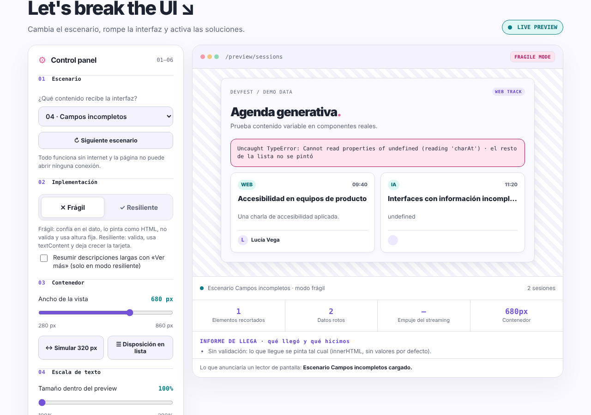
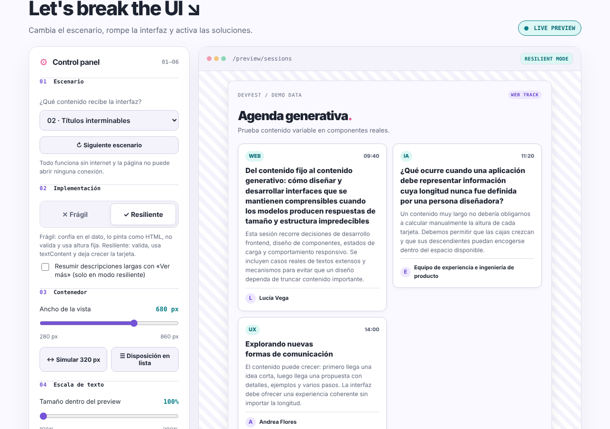

# No More Lorem Ipsum · AI Content Stress Lab

Laboratorio de mi charla **«No More Lorem Ipsum: CSS para interfaces con contenido generado por IA»** (DevFest Arequipa 2026).

Una tarjeta de agenda recibe contenido que no controlas: títulos de 300 caracteres, URL sin espacios, campos ausentes, HTML, respuestas de IA con texto alrededor del JSON. El modo **Frágil** confía en todo; el modo **Resiliente** decide qué cede, qué se valida y qué se anuncia.

> **Cuando el contenido no cabe, algo tiene que ceder. Tu trabajo es decidir qué. Si no decides, decide el navegador.**

| Frágil | Resiliente |
|---|---|
|  |  |

## Úsalo

Abre **`index.html`** en el navegador (doble clic). No hay que instalar nada ni tener internet. El HTML, el CSS y el JavaScript están en archivos separados, así que **si lo copias a otro sitio, copia la carpeta completa** (`index.html`, `css/` y `js/`), no solo el HTML.

La página no puede abrir ninguna conexión: la Content-Security-Policy tiene `connect-src 'none'`.

## Estructura

```text
index.html               html
css/styles.css           estilos
js/data.js               respuestas de IA de ejemplo, escenarios y texto del streaming
js/llega.js              LLEGA: normalizeSession y parseAI (no tocan el DOM)
js/app.js                render, medidores, streaming y eventos
contenidos-hostiles/     escenarios en JSON, prompts, respuestas de ejemplo y criterios de aceptación
tests/                   pruebas con Playwright + axe-core
img/                     capturas del README
```

## Las cuatro etapas

| Etapa | Pregunta | Dónde verla |
|---|---|---|
| **LLEGA** (JavaScript) | ¿Qué pasa si el dato llega mal o no llega? | Escenarios 04 y 06, sección 06, «Informe de LLEGA» |
| **CABE** (CSS) | ¿Quién cede cuando no cabe? | Escenarios 02 y 03, «Resumir con Ver más», «Disposición en lista» |
| **FLUYE** (CSS + JS) | ¿Qué pasa mientras sigue llegando? | «Simular streaming», «Reservar espacio», «Empuje del streaming» |
| **SE USA** (accesibilidad) | ¿Se puede leer, navegar y entender? | «↔ Simular 320 px», «Lo que anunciaría un lector de pantalla» |

Después de cada prueba, la misma pregunta: **¿qué cedió?**

## Contenidos hostiles y criterios de aceptación

La carpeta [`contenidos-hostiles/`](contenidos-hostiles/) tiene los escenarios del laboratorio en JSON (`escenarios.json` es una copia de `fixtures` en `js/data.js`), tres prompts con respuestas de ejemplo y la lista de [criterios de aceptación](contenidos-hostiles/criterios-de-aceptacion.md); `npm test` comprueba casi todos. Cópialos a tu propio proyecto.

## Pruebas

Hace falta Node 18 o superior.

```bash
npm install
npm run setup       
npm test             
npm run test:stream   
```

`npm test` usa Playwright y axe-core, y guarda capturas y `results.json` en `test-results/`.

## Qué mide y qué no

- Los números del streaming (9 % de texto visible, 228 px de empuje, CLS ≈ 0,04) son de **Chromium a 1280 px**. Cambian con el navegador, su versión y la fuente instalada: pruébalos en tu equipo.
- axe-core detecta una parte de los problemas de accesibilidad. «0 violaciones» no es «cumple WCAG».
- No se probó en Safari ni Firefox, ni con un lector de pantalla real. En particular, que `css/` y `js/` carguen con la CSP al abrir `index.html` con doble clic solo está verificado en Chromium (y por HTTP, como en GitHub Pages).
- Las fallas del modo Frágil son deliberadas: no lo uses como implementación de producción.
- Los controles de ancho y de escala de texto son una simulación; verifica también el zoom real del navegador.

## Cómo se hizo

El laboratorio inicial se generó con Claude (Anthropic). La charla, las decisiones y la revisión son de Shir :3.

Fuentes citadas dentro del laboratorio: MDN, W3C WCAG 2.2 (1.4.10 Reflow) y OWASP Top 10 for LLM Applications (LLM05).
